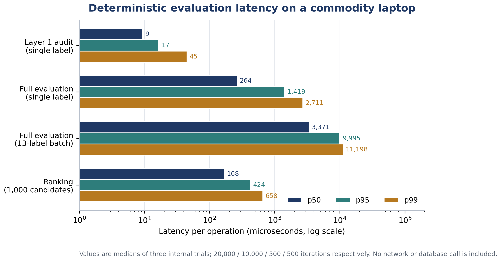

## Abstract

**Background.** Point-of-purchase food scanners promise to translate complex nutrition labels into simple guidance. Most published and commercial systems begin with a nutrient-profiling algorithm and assume that the underlying label record is complete, internally consistent, and comparable across products. In practice, packaged-food data are heterogeneous: nutrients are missing, declared on different bases, transcribed by crowdsourcing or optical character recognition (OCR), and sometimes physically impossible. Applying a score to such data converts uncertainty into apparent precision.

**Objective.** We present AaharIQ, a reference architecture and implementation that treats *evaluability*—whether a label can legitimately be evaluated at all—as a first-class output. The system separates measurement integrity from nutrition semantics, binds each declared nutrient to a per-field evidence record and declaration basis, tags every threshold with its legal status, and withholds grades when the evidence is insufficient.

**Methods.** The architecture has three deterministic layers: (i) a physical and arithmetic consistency audit based on FSSAI energy-conversion factors, mass conservation, component inequalities, and sodium–salt stoichiometry; (ii) a source-backed standards registry that distinguishes statutory mandates, official advisory guidelines, statutory label-reference values, draft proposals, and clinical heuristics; and (iii) an evaluability state machine and decision layer that issues a three-level frequency grade only when the label is complete, verified, basis-consistent, non-corrupt, and has at least three assessed nutrients. Six persona lenses add label-reading cautions without asserting diagnoses. We evaluated the implementation with a controlled fault-injection experiment on 13 synthetic base profiles crossed with 15 label conditions (195 cases), microbenchmarks of the deterministic path, and the project's automated test suite.

**Results.** All 13 clean profiles were graded (one green, three amber, nine red). All 78 corrupting faults and all 65 structural or provenance faults were withheld from grading (143/143). The 39 arithmetic contradictions were not withheld; they remained evaluable but were downgraded to `SUSPECT` in 39/39 cases, a deliberate fail-safe policy for conservative inconsistencies. Median full evaluation latency was 0.26 ms per label (p99 2.71 ms), a 13-label batch took 3.37 ms median, and ranking 1,000 swap candidates took 0.17 ms median. The automated suite passed 127/127 tests across 41 suites and eight files.

**Conclusions.** Measurement-integrity gating is computationally feasible at interactive speed and can be implemented without a large language model, a network call, or a proprietary scoring service. AaharIQ is not a field-validated consumer product and does not establish clinical benefit; it is a testable architecture for making the preconditions of nutrition scoring explicit. The controlled experiment supports the internal behavior of the gates, not their prevalence or accuracy on the Indian market. A pre-registered field study with real packaged-food labels, OCR ground truth, and user outcomes is the necessary next step.

**Keywords:** front-of-pack nutrition labelling; food composition data; data provenance; fail-closed systems; nutrient profiling; clinical decision support; India

## Highlights

- Evaluability is treated as an explicit system output rather than an implicit assumption.
- Every nutrient is bound to per-field evidence, a declaration basis, and a verification status.
- Thresholds carry legal status, preventing advisory, statutory, draft, and clinical values from being conflated.
- The engine fails closed on corrupt, incomplete, unverified, or basis-mismatched labels, and fails safe with an advisory on arithmetic contradictions.
- In a controlled 195-case experiment, 143/143 corrupt or structural faults were withheld from grading, while 39/39 arithmetic contradictions were retained with a `SUSPECT` warning.
- The deterministic path evaluates a label in 0.26 ms median and ranks 1,000 candidates in 0.17 ms median.

## 1. Introduction

India's packaged-food supply has changed faster than the tools available to interpret it. Nationally representative data from the ICMR-INDIAB study (113,043 adults) estimate a diabetes prevalence of 11.4%, prediabetes of 15.3%, hypertension of 35.5%, general obesity of 28.6%, abdominal obesity of 39.5%, and dyslipidaemia of 81.2% [@anjana2023]. At the same time, the packaged food and beverage supply is increasingly dominated by energy-dense, ultra-processed formulations [@jones2017; @monteiro2019]. Analyses of the Indian market have documented a high prevalence of products that would be classified as unhealthy by nutrient-profiling models, alongside wide variation in price and availability [@jones2017; @dunford2021india]. Ultra-processed food exposure has been associated with adverse cardiometabolic and mental-health outcomes in large prospective cohorts and umbrella reviews [@srour2019; @lane2024; @elizabeth2020].

Front-of-pack nutrition labelling (FOPNL) is one policy response. Systematic reviews and network meta-analyses suggest that colour-coded and warning labels can shift consumer understanding and, more modestly, purchasing behaviour [@shangguan2019; @song2021; @khandpur2018]. In India, the choice of FOPNL format has been contested, and experimental work has examined how consumers interpret alternative designs [@pande2020; @pettigrew2023]. Yet even a well-designed label presupposes that the underlying nutrient values are complete and trustworthy. That presupposition is fragile.

Consumer-facing food scanners add a second layer of interpretation. A user scans a barcode or photographs a label; the app retrieves or extracts nutrient values; a scoring algorithm returns a number, colour, or star rating. FoodSwitch demonstrated that a large branded-food database, combined with a nutrient-profiling algorithm and healthier alternatives, can be operated at population scale [@dunford2014]. Diet-tracking apps show that digital tools can support self-monitoring, but also that usability, database quality, and estimation error shape what users actually receive [@ferrara2019; @konig2021]. A quality assessment of barcode-linked food databases found material mismatch between database records and the physical labels they represented [@maringer2018]. OCR introduces additional error, and crowdsourcing introduces incentives for both accidental and deliberate contamination [@smith2007; @boushey2017].

The dominant response to these problems has been to improve the scoring function: refine nutrient-profile thresholds, add food-additive penalties, incorporate processing classification, or train a better classifier. That response is necessary but incomplete. A score is a function of its inputs. If a nutrient value is missing, the algorithm may silently treat it as zero; if added sugar is absent, total sugar may be substituted; if a per-serving value is compared with a per-100 g threshold, the units may be silently converted; if a transcription is wrong, the score may be confidently wrong. The result is not merely a noisy measurement. It is *confidence laundering*: uncertain, incomplete, or fabricated data acquire the appearance of a precise health judgement.

This paper starts from a different premise: **measurement before meaning**. Before asking "is this product healthy?", a system should ask "is this label evaluable, and on what evidence?" AaharIQ is a reference architecture and implementation built around that question. It does not propose a new nutrient-profiling algorithm. It proposes a way to make the preconditions of nutrition scoring explicit, auditable, and enforceable.

### 1.1 Contributions

The contributions of this work are:

1. **A measurement-integrity layer before nutrition semantics.** We formalise a consistency audit that combines FSSAI energy-conversion factors, mass conservation, component inequalities, and sodium–salt stoichiometry, and we show how it can be separated from the choice of nutrient-profile thresholds.
2. **A fail-closed evaluability state machine.** We define five states—`EVALUABLE`, `SOURCE_UNVERIFIED`, `LABEL_INCOMPLETE`, `BASIS_MISMATCH`, and `NOT_EVALUABLE`—with explicit precedence, and we make grade issuance conditional on the state.
3. **A legal-status-aware, provenance-bound threshold registry.** Every threshold is tagged as a statutory mandate, official advisory, statutory label reference, draft proposal, or clinical heuristic. The system does not apply a draft or clinical value as if it were law.
4. **An explicit separation between advisory grades and clinical lenses.** Six persona lenses provide label-reading cautions, but each carries a written non-claim: for example, the diabetic lens does not invent a per-serving sugar ceiling, and the renal lens never returns green merely because a potassium-chloride additive is absent.
5. **A price-parity, same-aisle swap engine with non-regression guards.** Candidate swaps must be verified, graded, same-category (by default), same-basis, allergen-safe, and within a caller-specified price premium; they must improve at least one assessed dimension without a hidden regression, and the response reports trade-offs.
6. **An anti-poisoning crowdsourced ingestion path.** OCR transcriptions are explicitly marked unverified and are grade-ineligible; community submissions remain pending review and are never auto-promoted.
7. **A deterministic, non-LLM decision path with a reproducible evaluation harness.** The same inputs produce the same outputs, and the fault-injection experiment is a standalone script whose JSON output is included with the manuscript.

### 1.2 Scope and evidence statement

This is a systems paper, not a field evaluation. The implementation is a backend service; the repository does not contain a mobile application. The empirical work reported here is a controlled fault-injection experiment on synthetic label profiles, a microbenchmark of the deterministic path, and the project's automated test suite. It does not estimate the prevalence of label defects in the Indian market, the accuracy of OCR on real pack images, or the effect of the system on consumer behaviour or health outcomes. Those questions require different designs and are stated as future work. The paper is explicit about this boundary because the credibility of a measurement-integrity system depends on not overstating what has been measured.

## 2. Related Work

### 2.1 Front-of-pack labelling and nutrient profiling

Nutrient-profiling models reduce multiple nutrients to a single summary. Nutri-Score, the Health Star Rating (HSR), warning-label systems, and the WHO regional nutrient-profile models differ in their thresholds, category adjustments, and treatment of beneficial components [@azais2006; @labonte2017]. Comparisons of Nutri-Score and HSR on large branded-food databases show substantial disagreement at the product level, even when both are intended to rank the same construct [@hafner2023]. Validation work on Nutri-Score has examined its ability to discriminate nutritional quality and to predict health outcomes, while also noting the limits of the validation evidence [@vanderbend2022].

The Indian policy context is distinctive. FOPNL has been debated for years, with disagreements about whether the label should be a warning, a colour-coded scale, or a numeric score [@pande2020]. Experimental evidence from India suggests that label format affects consumer interpretation and that low-literacy contexts require particular care [@pettigrew2023]. The 2024 ICMR-NIN Dietary Guidelines for Indians provide a set of advisory HFSS thresholds in Table 15.1, but these are guidance, not a statutory product grade [@icmr2024]. The FSSAI Labelling and Display Regulations, 2020 specify the nutrition information that must be declared and the reference values used for %RDA, but those reference values are labelling references, not health limits [@fssai2020]. The FSSAI Advertising and Claims Regulations, 2018 define the conditions under which claims such as "sugar free" or "high protein" may be made [@fssai2018].

A system that treats all of these numbers as interchangeable will make category errors. A 25 g daily added-sugar reference is not a per-snack ceiling. A 50 g %RDA reference is not a health limit. A 3 g/100 g Table 15.1 threshold is an advisory screening cutoff, not a statutory ban. A draft school-food proposal is not law. A clinical guideline's caution is not a diagnosis. The legal-status problem is therefore not a documentation detail; it is a correctness problem.

### 2.2 Food scanning, crowdsourcing, and database quality

FoodSwitch is the closest prior system. It combines a branded-food database, a nutrient-profiling algorithm, and suggestions for healthier alternatives, and it has been used to crowdsource updates to national food composition data [@dunford2014]. Its scale and population reach are substantially greater than anything reported in this paper. The relevant gap is not coverage but *evidence binding*: a product-level database record does not, by itself, establish that each nutrient value is complete, verified, and declared on the same basis as the threshold being applied.

Database quality studies reinforce the concern. Maringer et al. assessed the labelled food-product databases underlying popular nutrition applications in the Netherlands and found that barcode matching and nutrient values were not uniformly accurate [@maringer2018]. Diet-tracking reviews report similar issues: users may select the wrong food, portion estimates are uncertain, and nutrient databases vary in completeness [@ferrara2019]. Usability studies identify barriers to sustained use, including burden, trust, and mismatch with everyday routines [@konig2021]. Image-based dietary assessment research has advanced the extraction of food and portion information, but it also documents the gap between a photograph and a verified nutrient record [@boushey2017].

OCR is a mature but imperfect ingestion technology. Tesseract remains a widely used open-source engine, and its accuracy depends strongly on image quality, layout, and language [@smith2007]. Nutrition tables are a difficult OCR target: values are small, columns are dense, units are abbreviated, and the same glyph can be a decimal point or a speck of noise. A transcription therefore carries uncertainty that a text string alone does not represent. The design question is how that uncertainty should propagate into a health judgement.

### 2.3 Clinical decision support and automation bias

Clinical decision support systems can improve process quality, but they can also introduce alert fatigue, automation bias, and over-reliance on incorrect recommendations [@sutton2020; @goddard2012]. A food scanner is not a clinical decision support system in the regulatory sense, but it occupies a similar epistemic position: it offers a simplified judgement about a complex object, at the point of decision, to a user who may not have the expertise to audit it. The lesson from CDSS research is not that simplified judgements are always inappropriate. It is that the system should communicate uncertainty, scope, and the conditions under which the judgement does not apply.

AaharIQ takes this lesson literally. Each clinical lens has a written non-claim. The diabetic lens does not assert a 4 g per-serving ceiling because the RSSDI 2022 recommendations do not contain one [@rssdi2022]. The cardiac lens uses 400 mg of sodium as 20% of the ICMR-NIN 2,000 mg daily reference, and says so, rather than presenting it as a Cardiological Society of India per-snack cutoff. The renal lens never returns green merely because INS 508 (potassium chloride) is absent, because Indian labels are not required to declare potassium or phosphorus and the absence of one additive does not establish renal safety [@kdigo2024]. These are not marketing disclaimers; they are encoded constraints on what the system is allowed to say.

### 2.4 Data quality, provenance, and reproducibility

The information-systems literature has long distinguished accuracy from other dimensions of data quality, including completeness, consistency, timeliness, and believability [@wang1996]. A nutrition record can be accurate in the sense that a value was copied correctly, yet still be unusable because the basis is wrong, a required field is missing, or the source is not the label it claims to be. Provenance is therefore not metadata decoration; it is part of the measurement.

The FAIR principles argue for findable, accessible, interoperable, and reusable data, with explicit metadata about origin and processing [@wilkinson2016]. Reproducible-research work emphasises the ability to re-run an analysis from the same inputs and code [@peng2011], and open-science initiatives stress complete reporting and transparent materials [@nosek2015]. AaharIQ's benchmark harness and JSON output are a small contribution in that direction: the experiment is a script, the synthetic inputs are in the script, and the outputs are machine-readable.

Fault injection is an established technique for evaluating dependability. It deliberately introduces faults to test whether a system detects, contains, or propagates them [@hsueh1997; @arlat1993]. The experiment in this paper applies the same logic to label data: rather than waiting for naturally occurring defects, it injects them into controlled profiles and observes whether the evaluability layer withholds a grade. This is a better fit to the research question than a correlational field study, because the question is whether the gate works, not whether defects are common.

### 2.5 Positioning

The gap addressed by this paper is not a better nutrient-profile formula. It is the absence, in the published food-scanner literature, of an explicit and enforceable boundary between *data* and *judgement*. FoodSwitch and nutrient-profile labels operate at the level of the score; diet trackers operate at the level of intake; database-quality studies describe the problem without changing the scoring pipeline. AaharIQ operates one level earlier: it decides whether a score may be issued, on what evidence, under which standard, and with which non-claims. To our knowledge, no peer-reviewed system combines per-field provenance, basis gating, physical plausibility checks, legal-status tagging, fail-closed evaluability states, persona-specific non-claims, and price-parity swaps in a single deterministic pipeline. The claim is architectural and is evaluated as such.

## 3. Design Goals and Novelty

### 3.1 Design principles

The design is governed by eight principles. They are stated as constraints, not aspirations, because each one rules out a class of implementations that would otherwise be simpler.

**P1. Measurement before meaning.** The system must decide whether a label is evaluable before it decides whether a product is healthy. A grade without an evaluability report is treated as a defect.

**P2. Fail closed on unverifiable, incomplete, or physically impossible data; fail safe on conservative arithmetic contradictions.** A missing required field, an unverified source, a basis mismatch, or a corrupt physical audit suppresses the grade. An arithmetic contradiction that cannot make the product look healthier than the clean label (for example, added sugar declared above total sugar) is retained with an explicit `SUSPECT` warning. This distinction is developed in Section 5.4.

**P3. Provenance is per field, not per product.** A product-level statement such as "data from a manufacturer" is insufficient. Each nutrient value must carry an evidence kind, a source identifier, a basis, a locator or artefact descriptor, and a verification status.

**P4. Legal status is a property of a threshold.** The system must not apply a draft, advisory, label-reference, or clinical value as if it were a statutory mandate. The registry records the status and the citation alongside the number.

**P5. Advisory grades and clinical lenses are different objects.** The population-level grade answers "how does this product compare with the DGI 2024 Table 15.1 references?" The clinical lenses answer "what might a person with this label-reading concern want to notice?" They are not diagnoses, prescriptions, or individual risk predictions.

**P6. Swaps must be structurally feasible.** A healthier alternative that is more expensive than the caller's ceiling, in a different aisle, on a different declaration basis, or unsafe for a declared allergen is not an alternative. The engine must also report the trade-offs of the swap it recommends.

**P7. Crowdsourcing must not be able to poison the grade.** A transcription, a community submission, or an OCR extraction is evidence of a claim, not proof of a fact. It must remain grade-ineligible until a reviewer attaches a verifiable pack record.

**P8. The decision path must be deterministic and auditable.** The same inputs must produce the same outputs, with no network call, no model sampling, and no hidden state. This is a precondition for reproducibility and for explaining a verdict to a regulator, clinician, or user.

### 3.2 Comparison with prior systems

Table 1 compares AaharIQ with four classes of prior work: FoodSwitch, nutrient-profile labels (Nutri-Score and HSR), commercial score-first scanners, and diet-tracking apps. The comparison is capability-based, not a benchmark of accuracy or population reach. "Not documented" means that the cited peer-reviewed literature does not describe the capability; it does not prove that a proprietary implementation lacks it.

**Table 1.** Capability comparison with representative prior systems. The comparison is based on published descriptions, not on reverse-engineering proprietary products.

| Capability | FoodSwitch [@dunford2014] | Nutri-Score / HSR [@hafner2023; @vanderbend2022] | Commercial score-first scanners | Diet trackers [@ferrara2019; @konig2021] | AaharIQ (this work) |
|---|---|---|---|---|---|
| Primary output | Nutrient-profile comparison and healthier swaps | Score, stars, or colour | Proprietary score or rating | Intake and nutrient estimates | Evaluability-gated frequency grade plus reasons |
| Per-field evidence and verification status | Product-level source; not a per-field basis gate | No; algorithm consumes declared values | Not documented in peer-reviewed literature | User-entered or database record | Yes; every nutrient value carries evidence, basis, and status |
| Physical plausibility audit | Not reported | Not reported | Not documented | Not applicable | Atwater, mass, component, and sodium–salt checks |
| Basis-mismatch detection | Not reported | Not reported | Not documented | Portion mismatch is a known error source | Yes; per-100 g, per-100 mL, and per-serving evidence are never silently converted |
| Legal-status tagging of thresholds | Not reported | Algorithm is statutory or voluntary, but thresholds are not individually status-tagged | Not documented | Not applicable | Statutory, advisory, label-reference, draft, and clinical values are distinct |
| Withholds output when the label is incomplete | Not a documented gate | Scores can be computed from available components | Not documented | Estimates can be produced from partial entries | Yes; grade is withheld in four non-evaluable states |
| Persona-specific non-claims | Population-level | Population-level | Not documented | Goal-based, not clinical | Six lenses, each with an explicit non-claim |
| Price-parity same-aisle swaps | Swaps are core; price varies by market | No | No | No | Yes, with a default +20% ceiling and non-regression guards |
| Anti-poisoning crowd ingestion | Crowdsourced updates with curation | Not applicable | Not documented | Not applicable | OCR and community submissions are grade-ineligible until reviewed |
| Deterministic, non-LLM decision path | Deterministic algorithm | Deterministic algorithm | Not documented | Deterministic estimation | Yes; no model call in the decision path |

The closest system is FoodSwitch. It has a much larger database, a population-scale deployment, and a body of evaluation that AaharIQ does not have. The contribution of AaharIQ is not to replace that infrastructure but to specify an integrity layer that could sit in front of it. In that sense, the comparison is complementary: FoodSwitch answers "what are healthier alternatives in this category?"; AaharIQ asks "is this label record strong enough to justify any answer at all?"

### 3.3 Novel contributions

The novelty of this work is architectural and methodological, not a new nutrient-profile coefficient. We make five specific claims.

**C1. Evaluability as a first-class output.** Prior systems treat data quality as an input-validation step, a preprocessing concern, or a disclaimer. AaharIQ exposes a five-state evaluability report as part of the primary response, with explicit precedence and a machine-readable reason. The grade is a function of that state, not a separate path that happens to check for missing values.

**C2. Per-field evidence binding with basis gating.** The system does not accept a nutrient value without an admissible evidence record, and it refuses to compare a per-serving value with a per-100 g threshold. The refusal is the feature: silent unit conversion is a common source of plausible but wrong advice.

**C3. Legal-status-aware thresholds.** The registry distinguishes `STATUTORY_MANDATE`, `OFFICIAL_ADVISORY`, `STATUTORY_LABEL_REFERENCE`, `DRAFT_PROPOSAL`, and `CLINICAL_HEURISTIC`. This prevents the most common category error in nutrition apps: treating a labelling reference or a daily guideline as a per-product legal limit.

**C4. Advisory–clinical separation with encoded non-claims.** The system's clinical lenses are deliberately weak. They flag added sugar, refined-carbohydrate markers, sodium share, saturated-fat share, INS 508, and INS 621, but they do not diagnose, predict glycemic response, or certify renal safety. The non-claims are part of the implementation, not a footnote.

**C5. Structural swap feasibility.** The swap engine combines nutritional improvement with same-aisle availability, same-basis comparison, allergen exclusion, a price-premium ceiling, and non-regression guards. It reports trade-offs rather than presenting a swap as unambiguously better.

Two further contributions are implementation-level: the anti-poisoning ingestion path (C6) and the deterministic, reproducible evaluation harness (C7). They are less conceptually novel than C1–C5, but they are necessary for the architecture to be credible in operation.

## 4. System Architecture

### 4.1 Overview

The architecture is organised around a single constraint: the evaluator never receives a nutrient value without also receiving the conditions under which that value may be used. Figure 1 shows the resulting path. A declared label record and its per-field evidence enter a measurement-integrity audit (Layer 1). The output of that audit, together with the evidence and basis gate, determines whether the record is admissible. Only an admissible record reaches the source-backed standards registry (Layer 2) and the evaluability and decision layer (Layer 3). A failure at either gate produces an explicit non-evaluable response rather than a low-confidence score.

**Figure 1.** Deterministic evaluation path and ingestion governance. The decision path uses only declared values, per-field evidence descriptors, and a versioned standards registry; it contains no language model and makes no network call. Crowdsourced and OCR records remain outside the decision path until a reviewer attaches a verifiable pack artefact.

The separation is deliberate. A conventional scanner pipeline is a sequence of transformations: retrieve, parse, normalise, score. Each transformation is assumed to preserve validity. AaharIQ inserts two explicit validity judgements between retrieval and scoring, and it makes those judgements part of the response rather than an internal exception. Table 2 summarises the responsibilities and failure behaviour of each layer.

**Table 2.** Architectural layers, their inputs and outputs, and their failure behaviour.

| Layer | Question | Principal inputs | Outputs | Failure behaviour |
|---|---|---|---|---|
| Layer 1: measurement integrity | Is the label internally possible and arithmetically coherent? | Per-100 g or per-100 ml values; product class; optional fibre, polyols, and IFCT staple context | `HIGH`, `SUSPECT`, or `CORRUPT` confidence; Atwater, mass, component, and sodium–salt checks | `CORRUPT` withholds the grade; `SUSPECT` is retained with an explicit warning |
| Evidence and basis gate | Is each value admissible, and is it on the basis the threshold expects? | Per-field evidence map; declared basis; packaged versus generic context | Missing, unsupported, derived, and basis-mismatch field lists | Any missing, unsupported, or mismatched field withholds the grade |
| Layer 2: source-backed standards | Which number applies, and what is its legal status? | Product class and form; versioned standards registry | Thresholds, citations, legal status, and non-claims | Only registered standards are applied; advisory, draft, label-reference, and clinical values are not promoted to statutory limits |
| Layer 3: evaluability and decision | May a grade be issued, and what does it mean? | Layer 1 result; gate result; Layer 2 thresholds; declared ingredients and claims | Evaluability state, frequency grade, reasons, persona verdicts, claims audit, swap inputs | Grade issued only when the record is complete, verified, basis-consistent, non-corrupt, and has at least three assessed criteria |

### 4.2 Per-field evidence and the admissibility predicate

A nutrient value is represented as a pair \((v_f, e_f)\) for each field \(f\), where \(v_f\) is the declared number and \(e_f\) is an evidence descriptor. The descriptor is a six-tuple

\[
e_f = (k_f,\ s_f,\ b_f,\ \ell_f,\ a_f,\ \nu_f),
\]

where \(k_f\) is the evidence kind, \(s_f\) the source identifier, \(b_f\) the declaration basis, \(\ell_f\) a locator within the source, \(a_f\) an artefact descriptor (hash, URL, or capture timestamp), and \(\nu_f\) the verification status. The implementation accepts a field only when all of the following hold:

1. \(k_f\) is `MANUFACTURER_LABEL`;
2. \(\nu_f\) is `VERIFIED`;
3. at least one of `artifactHash`, `sourceUrl`, or `capturedAt` is present;
4. \(s_f\) begins with `PACK_PHOTO:`, `MANUFACTURER_LABEL:`, `LAB_TEST:`, or `OCR_CAPTURE:`; and
5. \(b_f\) equals the declared basis of the record and is either `PER_100G` or `PER_100ML`.

The only permitted derived values are the sodium–salt conversions `saltG = sodiumMg × 2.5 / 1000` and `sodiumMg = saltG × 400`. A derived field is admissible only when the formula and its input field are both recorded. For generic, unbranded foods, an official composition table (ICMR-NIN IFCT 2017) is admissible when the source is registered, the record is marked as a composition source, and a locator is present. It is not admissible for a packaged product, because a composition table describes a food, not the specific pack in the user's hand.

Two consequences are important. First, a product-level statement such as "data from the manufacturer" does not satisfy the predicate; evidence is bound per field. Second, an absent value is `null`, never zero. The engine does not substitute total sugar for added sugar, total fat for added fat, or a missing sodium value with a value inferred from ingredients. The same rule applies to the claims audit: a claim that cannot be checked against a declared value is reported as unverifiable, not as compliant.

The current implementation does not compute a cryptographic hash of an uploaded pack image. The OCR path accepts client-supplied text and marks every extracted field `TRANSCRIBED_UNVERIFIED`; a reviewer may later attach an `artifactHash`. This is a real limitation of the present codebase, and it is why OCR output is grade-ineligible by construction rather than by configuration. The schema supports a reviewer-supplied artefact descriptor, but the capture pipeline that would produce one is not part of this repository.

### 4.3 The standards registry

Layer 2 is a versioned registry rather than a collection of constants embedded in scoring code. Each entry records the numeric value, the unit, the issuing authority, the document and clause, the version or year, the legal status, and a derivation note. Five statuses are distinguished: `STATUTORY_MANDATE`, `OFFICIAL_ADVISORY`, `STATUTORY_LABEL_REFERENCE`, `DRAFT_PROPOSAL`, and `CLINICAL_HEURISTIC`. The status is not decorative. It determines whether a value may be described as a legal limit, an advisory screening reference, a labelling reference, a proposal, or a clinical caution.

Table 3 lists the reference values used by the evaluator and the role each is allowed to play. The distinction between a daily reference and a per-product threshold is particularly important. The FSSAI %RDA table, for example, uses 50 g of added sugar as a labelling reference for a 2,000 kcal diet. That number is not a per-snack ceiling, and the engine does not use it as one. The ICMR-NIN daily reference of 25 g added sugar is also a daily value; the engine uses it only to calculate a serving's share of the daily reference, not to classify the product. The product-level screen uses the per-100 g and per-100 ml Table 15.1 thresholds.

**Table 3.** Reference values, legal status, and the role each is permitted to play in the evaluator.

| Reference | Value used | Legal status | Permitted role | Not permitted |
|---|---|---|---|---|
| ICMR-NIN DGI 2024, Table 15.1, solid foods [@icmr2024] | Energy 250 kcal, added sugar 3.0 g, added fat 4.2 g, salt 625 mg per 100 g | `OFFICIAL_ADVISORY` | Per-100 g HFSS screening of declared nutrients | Statutory ban, clinical diagnosis, or individual risk prediction |
| ICMR-NIN DGI 2024, Table 15.1, beverages [@icmr2024] | Energy 70 kcal, added sugar 2.0 g, added fat 1.5 g, salt 175 mg per 100 ml | `OFFICIAL_ADVISORY` | Per-100 ml HFSS screening of declared beverages | Application to sauces or other liquid foods declared per 100 g |
| ICMR-NIN DGI 2024, daily references [@icmr2024] | Sodium 2,000 mg, added sugar 25 g, saturated fat 5% of energy per day | `OFFICIAL_ADVISORY` | Daily-reference shares and saturated-fat energy share | Per-snack legal limit or clinical prescription |
| FSSAI Labelling and Display Regulations, 2020 [@fssai2020] | Energy 2,000 kcal, fat 67 g, saturated fat 22 g, trans fat 2 g, added sugar 50 g, sodium 2,000 mg | `STATUTORY_LABEL_REFERENCE` | %RDA labelling context and mandatory-field definition | Health limit or product grade |
| FSSAI Advertising and Claims Regulations, 2018 [@fssai2018] | Claim-specific thresholds (e.g. sugar-free \(\le 0.5\) g/100 g; high protein \(\ge 10.8\) g/100 g for solids) | `STATUTORY_MANDATE` | Verification of explicit front-of-pack claims | Implicit health endorsement of the product |
| Draft FSSAI school-food amendment, 2026 | Mirrors DGI 2024 HFSS values where stated | `DRAFT_PROPOSAL` | Explanation of why the draft is not applied | Application as final law or as an adult product grade |
| RSSDI 2022 clinical recommendations [@rssdi2022] | No numeric per-serving sugar ceiling; refined-carbohydrate caution | `CLINICAL_HEURISTIC` | Ingredient and added-sugar caution in the diabetic lens | A 4 g per-serving cutoff, glycemic prediction, or treatment advice |
| KDIGO 2024 CKD guideline [@kdigo2024] | Potassium-chloride salt substitutes may be unsuitable for some patients | `CLINICAL_HEURISTIC` | INS 508 avoidance prompt in the renal lens | Certification of renal safety from a label |
| WHO 2023 non-sugar sweetener guideline [@who2023nss] | Conditional recommendation; no child-specific guidance | `OFFICIAL_ADVISORY` | Caution when a non-sugar sweetener is decoded | Pediatric ban or weight-management prescription |

### 4.4 The decision layer and response contract

Layer 3 is a pure function of the two gates and the resolved standards. Its output is not a single score. The response contains the consistency audit, the source-integrity report, the evaluability report, the five Table 15.1 checks with their individual citations, the frequency grade, an `isGraded` flag, a list of reasons, six persona verdicts, the claims audit, the ingredient and processing analysis, and the visualiser values (teaspoons of sugar, grams of salt, and daily-reference shares). This structure is intentional: a caller can audit why a grade was issued, which criterion was breached, which standard was used, and which fields were missing or unverified.

The response also separates the evaluability state from the grade. `evaluability.status` describes the evidentiary state of the record. `frequencyGrade` describes the product-level screen. `isGraded` states whether the grade may be shown. In the common case the three agree, but they are not redundant: a record can be `EVALUABLE` and still fail the minimum-assessed-criteria rule, in which case the grade is `NOT_EVALUABLE` and `canShowGrade` is false. Keeping the three fields separate prevents a caller from inferring that a missing grade necessarily means missing data.

### 4.5 Operational envelope

The reference implementation is a TypeScript service on Node.js 20 or later, using Fastify 4.26, Zod schemas, Drizzle ORM, and PostgreSQL. The evaluation path itself is stateless and synchronous; persistence is confined to authentication, the product catalogue, and the moderation queue. Authentication uses JWT, passwords are hashed with bcrypt, Helmet sets security headers, and route-level rate limits are applied to OCR and submission endpoints. The Open Food Facts client is an ingestion convenience, not an evidence source: it is rate-limited to 12 requests per minute, caches positive results for 24 hours and negative results for 2 hours, and marks retrieved records `TRANSCRIBED_UNVERIFIED`. Such records may be displayed as leads but cannot receive a grade.

## 5. Methods

### 5.1 Formal model

Let \(F\) be the set of nutrient fields, \(L = \{(v_f, e_f, b_f)\}_{f \in F}\) a label record, \(c\) the nutrition context (packaged product or generic food), and \(R\) the standards registry. The evaluator is a composition of five maps:

\[
L \rightarrow L' \rightarrow A \rightarrow S \rightarrow T \rightarrow D,
\]

where the first arrow is normalisation, \(A\) is the consistency audit, \(S\) the source-integrity report, \(T\) the resolved thresholds, and \(D\) the decision object. Each map is deterministic and side-effect free. The only inputs are the record, the context, and the registry; there is no random seed, model sample, clock-dependent branch, or network call in the path.

### 5.2 Layer 1: physical and arithmetic consistency

The energy audit compares the declared energy \(E_{\mathrm{decl}}\) with two calculations. The standard Atwater calculation is

\[
E_{\mathrm{std}} = 4P + 4C + 9F,
\]

where \(P\), \(C\), and \(F\) are protein, carbohydrate, and total fat in grams per 100 g or 100 ml. The FSSAI energy equation for labels that declare fibre or polyols is

\[
E_{\mathrm{FSSAI}} = 4P + 4\max(0, C - F_{\mathrm{ib}} - P_{\mathrm{ol}}) + 2(F_{\mathrm{ib}} + P_{\mathrm{ol}}) + 9F,
\]

where \(F_{\mathrm{ib}}\) is dietary fibre and \(P_{\mathrm{ol}}\) is polyols. The relative discrepancy is

\[
d = \frac{\left|E_{\mathrm{decl}} - E_{\mathrm{calc}}\right|}{E_{\mathrm{decl}}},
\]

with the convention that \(d=1\) when \(E_{\mathrm{decl}}=0\) and \(E_{\mathrm{std}}>0\), and \(d=0\) when both are zero. When fibre or polyols are declared, the engine computes both candidates and uses the FSSAI value only if the standard discrepancy exceeds 8% and the FSSAI value is closer to the declaration; otherwise it uses the standard Atwater value. This prevents a fibre-containing product from being marked corrupt merely because the label uses the statutory equation.

The discrepancy is tiered rather than dichotomised: the audit returns `HIGH` when \(d \le 0.08\), `SUSPECT` when \(0.08 < d \le 0.20\), and `CORRUPT` when \(d > 0.20\). The 8% and 20% boundaries are implementation tolerances, not statutory limits. They were chosen so that rounding and analytical variation do not trigger a block, while a decimal shift or a missing macronutrient does. The paper reports the boundaries explicitly because they are policy parameters that a deployer may need to audit or revise.

Mass conservation is checked with a 2 g allowance for rounding and mineral mass:

\[
M = P + C + F + \frac{N_a}{1000} \leq 102\ \mathrm{g\ per\ 100\ g}.
\]

The sodium–salt check uses the stoichiometric relation \(N_a^{\text{salt}} = 400 \times S\), where \(S\) is salt in grams. A label is contradictory when

\[
\left|N_a - 400S\right| > \max(25,\ 0.1N_a).
\]

Component inequalities are also checked: total sugar must not exceed carbohydrate; added sugar must not exceed total sugar; saturated fat plus trans fat must not exceed total fat; and added fat, when declared, must not exceed total fat. A failure of any of these inequalities sets the label-consistency flag to false. Unlike a mass violation or an energy discrepancy above 20%, it does not by itself set the overall confidence to `CORRUPT`; the rationale is developed in Section 5.4.

For generic foods, an optional IFCT 2017 staple-bounds check compares the declared macronutrient profile with broad composition ranges for the named staple. A failure is treated as `CORRUPT`. The check is not applied to packaged products, because a branded formulation may legitimately fall outside a raw-commodity range.

### 5.3 Layer 2: evidence admissibility and basis gating

The source-integrity report partitions the declared fields into four sets: missing required fields \(M\), unsupported fields \(U\), basis-mismatch fields \(B\), and optional missing fields \(O\). For a packaged product, the required set is energy, protein, carbohydrate, total sugar, added sugar, total fat, saturated fat, trans fat, and cholesterol, plus sodium or salt. For a generic food, the required set is energy, protein, carbohydrate, total fat, and sodium or salt. Added fat, fibre, and polyols are optional for evaluation.

A field is unsupported when it has a numeric value but no admissible evidence. A field is basis-mismatched when its evidence is on a different basis from the record, or when its evidence is on a per-serving basis. The engine does not convert per-serving evidence to per-100 g, even when a serving size is declared. Conversion is arithmetically trivial but epistemically unsafe: it assumes that the declared serving size is correct, that the nutrient is homogeneously distributed, and that the label's per-serving value and per-100 g value refer to the same preparation. The system refuses the conversion and reports `BASIS_MISMATCH`.

The gate is conservative in a second sense. A field with a value of zero is treated as declared only when the input actually contains the number zero. An absent field is not zero. This matters for added sugar, trans fat, sodium, and cholesterol, all of which are frequently absent from incomplete transcriptions and all of which would make a product look better if imputed as zero.

### 5.4 Layer 3: evaluability and grade issuance

The evaluability state is assigned by precedence. `BASIS_MISMATCH` outranks `NOT_EVALUABLE`, which outranks `EVALUABLE`, which outranks `SOURCE_UNVERIFIED`, which outranks `LABEL_INCOMPLETE`. The precedence ensures that the reported reason is the most actionable one: a record that is both incomplete and basis-mismatched is reported as a basis mismatch, because converting the basis is a precondition for assessing completeness. Figure 2 shows the same order as a state machine, and Table 4 defines each state.

**Figure 2.** Evaluability precedence. Basis mismatch and physical corruption outrank completeness; completeness outranks provenance. The terminal “too few assessed nutrients” branch withholds the grade while the evaluability report may remain `EVALUABLE` with `canShowGrade = false`.

**Table 4.** Evaluability states, their definitions, and representative causes.

| State | Definition | Representative cause | Grade issued? |
|---|---|---|---|
| `BASIS_MISMATCH` | At least one declared field has evidence on a basis different from the record, or on a per-serving basis | A per-100 g record whose evidence is marked `PER_SERVING` | No |
| `NOT_EVALUABLE` | The Layer 1 audit returned `CORRUPT` | Mass above 102 g/100 g; energy discrepancy above 20%; sodium–salt conflict | No |
| `EVALUABLE` | All required fields are present, every declared field has admissible evidence, and no basis mismatch exists | A complete, verified manufacturer label on the correct basis | Yes, if at least three criteria are assessed |
| `SOURCE_UNVERIFIED` | All required fields are present, but at least one declared field lacks admissible evidence | An OCR transcription without a reviewer-supplied artefact | No |
| `LABEL_INCOMPLETE` | At least one required field is absent, and no higher-precedence condition applies | Added sugar, trans fat, or sodium not declared | No |

The grade is issued only when the record is complete, verified, basis-consistent, non-corrupt, and has at least three assessed criteria:

\[
\mathrm{isGraded} = C(L) \wedge \neg B(L) \wedge \neg K(L) \wedge \left(\sum_{j=1}^{5} \mathbf{1}[a_j \neq \mathrm{null}] \geq 3\right),
\]

where \(C(L)\) is completeness, \(B(L)\) is basis consistency, \(K(L)\) is the corrupt flag, and \(a_j\) are the five Table 15.1 criteria: energy, added sugar, added fat, salt, and saturated-fat energy share. The minimum of three prevents a grade from being computed from a single available nutrient. In practice, added fat is usually absent because it is not a mandatory Indian label field, so a complete packaged label usually has four assessed criteria: energy, added sugar, salt, and saturated fat.

The frequency grade maps the number of breached criteria \(n_b\) to a three-level label: zero breaches yield `SUITABLE_FOR_REGULAR_USE`, one breach yields `ENJOY_IN_MODERATION`, and two or more breaches yield `BEST_KEPT_OCCASIONAL`.

This mapping is a deliberate simplification. It is not a nutrient-profile score, and it does not weight nutrients differently. Its purpose is to make the decision rule inspectable: a user can see which criteria were breached and can disagree with the thresholds without having to reverse-engineer a composite index.

The treatment of arithmetic contradictions follows a conservative principle. The three component inequalities—added sugar above total sugar, total sugar above carbohydrate, and saturated fat above total fat—are retained as `SUSPECT` rather than blocked. In each case the offending value is an over-declaration of a health-relevant quantity or a value that is not used to make the product look better. Added sugar above total sugar cannot produce a more favourable grade than the declared added-sugar value would produce on its own; total sugar is not used in the grade; saturated fat above total fat cannot produce a more favourable saturated-fat share. The grade is therefore not made more permissive by the inconsistency, and the response carries an explicit warning. This is a fail-safe policy for conservative contradictions, not a general licence to grade inconsistent data. Mass violations, large energy discrepancies, sodium–salt conflicts, and IFCT staple violations remain `CORRUPT` and are withheld.

### 5.5 Persona lenses

The six persona lenses are label-reading heuristics, not diagnoses. Each lens has a rule, a status vocabulary, and a written non-claim. Table 5 summarises them. The adult lens mirrors the population grade. The diabetic lens flags any declared added sugar above zero, or a refined-carbohydrate marker in the ingredient list, and explicitly states that RSSDI 2022 contains no 4 g per-serving ceiling. The infant lens applies the DGI 2024 advice of no added sugar under two years and the FSSAI Schedule II warning for monosodium glutamate (INS 621); it also flags a sweetener marker that contradicts a zero added-sugar declaration. The child lens flags non-sugar sweeteners and added sugar without asserting a child-specific gram ceiling. The cardiac lens flags a single-serving sodium value above 400 mg—20% of the 2,000 mg daily reference—or a saturated-fat share above 5% of energy, and states that this is not a Cardiological Society of India cutoff. The renal lens flags INS 508 and otherwise never returns green, because Indian labels are not required to declare potassium or phosphorus.

**Table 5.** Persona lenses, decision rules, and encoded non-claims.

| Lens | Rule | Statuses | Encoded non-claim |
|---|---|---|---|
| General adult | Mirror the population grade; report daily-reference shares when a serving size is declared | Green, amber, insufficient data | The grade is an advisory screen, not a complete diet assessment |
| Diabetic / pre-diabetic | Added sugar \(>0\) or a refined-carbohydrate marker triggers caution | Green, amber, insufficient data | No 4 g per-serving ceiling; no glycemic prediction or treatment advice |
| Infant / toddler under 2 | Added sugar \(>0\) or MSG (INS 621) triggers avoid; a sweetener marker contradicting zero added sugar triggers caution | Green, red, amber, insufficient data | Only the added-sugar and MSG criteria are assessed; not an infant-food certification |
| Child aged 2+ | Non-sugar sweetener or added sugar triggers caution | Green, amber, insufficient data | No child-specific gram ceiling; WHO 2023 does not provide paediatric guidance |
| Hypertension / heart health | Single-serving sodium \(>400\) mg or saturated fat \(>5\%\) of energy triggers caution | Green, amber, insufficient data | 400 mg is 20% of a daily reference, not a CSI per-snack cutoff |
| Kidney / renal health | INS 508 triggers avoid; otherwise caution | Amber, red, insufficient data | Never green; absence of INS 508 does not establish renal safety |

### 5.6 Claims verification

Eight explicit front-of-pack claims are checked against the declared values and the FSSAI Advertising and Claims Regulations, 2018 [@fssai2018]: no added sugar, sugar free, high protein, source of protein, high fibre, source of fibre, low fat or fat free, trans fat free, cholesterol free, and low sodium or sodium free. The verifier uses the statutory thresholds for solids and liquids, and it returns one of three states: `VERIFIED_COMPLIANT`, `MISLEADING_BREACH`, or `CANNOT_BE_VERIFIED`. The "no added sugar" check additionally scans the ingredient list for sweetening agents, because a zero added-sugar declaration can coexist with a sweetening ingredient that the declaration does not capture. The claims audit is separate from the grade: a misleading claim is reported as a claim breach, not as a reason to withhold the nutrient grade.

### 5.7 Swap eligibility and lexicographic ranking

The swap engine returns healthier alternatives only when both the scanned product and the candidate are verified and gradeable. Candidates must be in the same category by default, on the same declaration basis, within a caller-specified price premium (default 20% above the scanned product's price per 100 g), and free of any allergen declared by the caller. Persona-specific exclusions are applied before ranking: infant candidates must have zero added sugar, no added-sugar ingredient, and no MSG; child candidates must not contain a non-sugar sweetener; renal candidates must not contain INS 508.

A candidate must satisfy a non-regression guard. It must not have more Table 15.1 breaches than the scanned product. For diabetic, child, and infant personas it must not have more added sugar; for cardiac and renal personas it must not have more sodium or more saturated fat. It must then improve at least one dimension: fewer breaches, at least 20% less added sugar, at least 20% less sodium, at least 20% less saturated fat, or at least 20% and at least 1 g more fibre without an increase in added sugar. When the scanned product already has zero breaches and zero added sugar, the candidate must have zero breaches, zero added sugar, and either lower sodium or higher fibre. This special case prevents a "swap" that is merely a different product with the same profile.

Eligible candidates are ordered lexicographically by persona. The adult order is fewest breaches, lowest added sugar, lowest sodium, highest fibre, then lowest price per 100 g. The diabetic order is lowest added sugar, fewest high-glycemic markers, highest fibre, lowest energy, then lowest price. The cardiac order is lowest sodium, lowest saturated fat, lowest trans fat, highest fibre, then lowest price. The renal order places INS 508 avoidance first, then sodium, saturated fat, and price. The infant order places zero added sugar first, then sodium, fewest additive codes, and saturated fat. The child order places added sugar, saturated fat, protein plus fibre, and price. The response reports both the advantages and the trade-offs of each recommended swap, including any remaining breaches and any price premium.

### 5.8 Controlled fault-injection experiment

The empirical evaluation asks a narrow question: when a label defect is present, does the system withhold the grade or warn, as its design claims? This is a dependability question, not a prevalence question. Fault injection is the appropriate design because the defect is introduced by the experimenter and the expected behaviour is known in advance [@hsueh1997; @arlat1993].

We constructed 13 synthetic base profiles spanning biscuits, savoury snacks, breakfast cereal, instant noodles, fruit juice, carbonated drinks, sweetened dairy, ketchup, chocolate, malted drinks, infant cereal, plain non-fat yogurt, and cooking oil. The profiles are not copies of commercial products and are not a probability sample of the Indian market. Each profile is a complete per-100 g or per-100 ml label with a declared serving size, package weight, ingredient list, and a per-field evidence record marked `VERIFIED` with a synthetic pack-photo identifier and capture timestamp. Energy is derived from the declared macronutrients so that every clean profile is Atwater-consistent by construction.

Each base was crossed with 15 conditions: the clean label and 14 faults. The faults fall into three categories. Six corrupting faults violate a physical or stoichiometric constraint: energy inflated by 50%, energy deflated by 50%, a tenfold decimal shift in energy, zero energy with non-zero macronutrients, a 40 g carbohydrate mass inflation, and a sodium–salt conflict. Three arithmetic faults violate a component inequality: added sugar above total sugar, total sugar above carbohydrate, and saturated fat above total fat. Five structural faults remove or degrade the evidence: added sugar absent, trans fat absent, sodium absent, per-serving evidence on a per-100 g record, and unverified evidence. The full crossing yields \(13 \times 15 = 195\) cases. The harness is a standalone TypeScript script; it evaluates each case through the public evaluation service, records the evaluability state, confidence, grade, and `isGraded` flag, and writes a machine-readable JSON file.

Two outcome definitions are used. A case is **blocked** when `isGraded` is false. A case is **warned** when the consistency audit returns a confidence other than `HIGH`. For corrupting and structural faults, the expected outcome is blocked. For arithmetic faults, the expected outcome is not blocked but warned, because the design retains conservative contradictions with a `SUSPECT` flag. This distinction is stated in advance and is the basis for interpreting the results; it would be inappropriate to count the arithmetic cases as failures of a gate that was designed not to block them.

### 5.9 Latency microbenchmarks

Latency was measured on the deterministic path only. The harness warms up each function for up to 2,000 iterations, then runs three trials per benchmark. It records per-iteration wall-clock time with `process.hrtime.bigint()` and reports the median of the three trial percentiles. Four operations were measured: the Layer 1 consistency audit on a single label (20,000 iterations per trial), the full deterministic evaluation of a single label (10,000 iterations), the full evaluation of the 13-label batch (500 iterations), and the lexicographic ranking of 1,000 synthetic candidates (500 iterations). The measurements exclude HTTP parsing, authentication, database access, OCR, and network calls. The machine was an Intel Core i3-1220P with 8 GB of RAM running Windows 11 and Node.js v23.5.0. The benchmark is a microbenchmark of algorithmic cost, not a service-level latency guarantee.

## 6. Implementation

### 6.1 Stack and module boundaries

The reference implementation is written in TypeScript 5.4 and runs on Node.js 20 or later. The HTTP layer is Fastify 4.26 with Zod request validation, Helmet security headers, JWT authentication, bcrypt password hashing, and per-route rate limits. Persistence uses PostgreSQL through Drizzle ORM; the evaluation path itself has no database dependency and can be exercised as a pure function. The code is organised into five feature modules—authentication, products, swaps, OCR, and health—around an engine module that contains the deterministic logic.

Within the engine, responsibilities are separated rather than merged into a single scoring service. `nutrient-verifier.ts` performs normalisation and the Layer 1 audit. `source-backed-engine.ts` implements the evidence and basis gate. `reference-standards.ts` holds the versioned registry and the legal-status citations. `evaluation.service.ts` composes the gates, applies the Table 15.1 screen, and constructs the persona verdicts. `claims-verifier.ts` checks front-of-pack claims against the FSSAI 2018 thresholds. `ingredient-parser.ts` decodes Indian ingredient declarations, INS codes, QUID obligations, statutory warnings, and the ICMR-NIN 2024 processing groups. `swaps.ranking.ts` is a pure lexicographic sorter; `swaps.service.ts` applies eligibility, price, allergen, and non-regression constraints before calling it.

The separation has a practical benefit: each rule can be tested without constructing an HTTP request. It also has a limitation: the same rule can be duplicated accidentally across modules. The test suite mitigates this by exercising the public evaluation service for the end-to-end behaviours and the individual modules for their boundaries, but it is not a formal proof of non-duplication.

### 6.2 HTTP surface

The public read surface consists of `GET /api/v1/health`, `GET /api/v1/products/barcode/:barcode`, `GET /api/v1/products`, and `GET /api/v1/swaps/:barcode`. The OCR surface consists of `POST /api/v1/ocr/parse`, which extracts fields from client-supplied text and returns a plausibility checklist without a grade; `POST /api/v1/ocr/evaluate`, which evaluates confirmed values but still withholds a grade because the evidence is marked unverified; and `POST /api/v1/ocr/submit`, which stages a community contribution for moderation. Product creation is protected and restricted to administrator and brand-representative roles. Authentication exposes registration, login, guest, Google, refresh, logout, password-reset, password-change, and username-change endpoints; the security-relevant behaviours include anti-enumeration on password reset and rejection of short passwords.

The OCR endpoints are deliberately not an OCR engine. They accept `rawText` from a client and parse it; the repository contains no image upload, no cloud vision call, and no computed image hash. This is stated here because a reader might otherwise infer that the reported evaluation includes OCR accuracy. It does not.

### 6.3 Automated test suite

The suite uses the Node.js test runner through `tsx` and contains 127 tests in 41 suites across eight files. All 127 pass on the evaluation machine in approximately 24 seconds. Table 6 reports the per-file distribution and the focus of each file. The counts are exact and were obtained by running each file individually; they replace the per-module breakdown reported in the earlier version of this manuscript, which was not reproducible from the repository.

**Table 6.** Automated test suite by file, with exact test counts.

| File | Focus | Tests |
|---|---|---:|
| `auth.test.ts` | Registration, login, guest and Google flows, refresh/logout, password reset and change, username update, anti-enumeration, token invalidation | 25 |
| `barcode.test.ts` | GTIN normalisation, check-digit validation, and malformed-input handling | 8 |
| `engine.test.ts` | Atwater formula selection, mass and sodium–salt checks, evidence admissibility, basis mismatch, evaluability, grade withholding, IFCT boundaries | 20 |
| `features.test.ts` | FSSAI licence decoding, claims verification, Atwater tiers, badge consistency, OFF cleansing, rate-limit keying, additive classes, statutory warnings, processing classification, QUID, mass and staple bounds | 33 |
| `health.test.ts` | Liveness endpoint | 1 |
| `ocr.test.ts` | Packaging-text parsing, plausibility checklist, unverified grading, moderation and rejection of corrupt submissions | 20 |
| `products.test.ts` | Barcode lookup, search, catalogue behaviour, and Open Food Facts fallback and caching | 10 |
| `swaps.test.ts` | Eligibility, price parity, allergen exclusion, non-regression guards, and persona ranking | 10 |
| **Total** | | **127** |

### 6.4 Reproducibility artefacts

Three artefacts accompany the manuscript. First, `server/benchmarks/paper-evaluation.ts` is the fault-injection and latency harness; it contains the 13 base profiles, the 14 faults, the expected outcome for each fault, and the percentile calculation. Second, `Research paper/benchmark-results.json` is the canonical output of that harness, including every case and every latency trial. Third, `Research paper/generate_figures_v2.py` regenerates Figures 1–4 from code and, for Figures 3 and 4, from the JSON output. The synthetic fixtures and the benchmark are self-contained; no commercial database or proprietary label record is required to reproduce them.

The repository also contains 13 unverified demo seed products used for interface development. They are deliberately marked unverified and cannot receive a grade; they are not the benchmark profiles and are not a market sample. This distinction matters because a reader who inspects the seed catalogue might otherwise mistake it for the evaluation dataset.

## 7. Evaluation

### 7.1 Questions and reporting conventions

The evaluation addresses three questions. **Q1:** When a label is corrupt, structurally incomplete, or provenance-poor, does the system withhold the grade? **Q2:** When a label contains a conservative arithmetic contradiction, does the system retain the grade only with an explicit warning? **Q3:** Is the deterministic path fast enough for interactive use? The first two questions are answered by the controlled fault-injection experiment; the third by the latency microbenchmarks. The automated test suite is reported as supporting evidence for implementation behaviour, not as an independent measure of field accuracy.

All proportions below are exact counts over a fixed, fully enumerated set of 195 cases. They are not estimates from a probability sample, and no confidence interval is attached. The appropriate interpretation is: within the specified fault model, the observed behaviour was exactly \(k/n\). Generalisation to the Indian market requires a different study.

### 7.2 Fault-injection results

Table 7 reports the outcome for each condition; Figure 3 shows the same data as a stacked bar chart. The clean control was graded in 13/13 cases. The grade distribution was one `SUITABLE_FOR_REGULAR_USE`, three `ENJOY_IN_MODERATION`, and nine `BEST_KEPT_OCCASIONAL`. The green case is the plain non-fat yogurt fixture, which was added as a positive control so that the experiment exercises the full grade range rather than only the amber and red states. The distribution is a property of the synthetic fixtures, not an estimate of the healthiness of the Indian packaged-food supply.

**Table 7.** Controlled fault-injection outcomes by condition. Each condition was applied to all 13 base profiles. "Withheld" means `isGraded = false`; "Issued" means a frequency grade was returned. Confidence and evaluability columns report the state observed in all 13 cases of that condition.

| Condition | Cases | Withheld | Issued | Consistency confidence | Evaluability state |
|---|---:|---:|---:|---|---|
| Clean label (control) | 13 | 0 | 13 | `HIGH` (13) | `EVALUABLE` (13) |
| Energy inflated by 50% | 13 | 13 | 0 | `CORRUPT` (13) | `NOT_EVALUABLE` (13) |
| Energy deflated by 50% | 13 | 13 | 0 | `CORRUPT` (13) | `NOT_EVALUABLE` (13) |
| Energy decimal shift (×10) | 13 | 13 | 0 | `CORRUPT` (13) | `NOT_EVALUABLE` (13) |
| Zero energy with non-zero macros | 13 | 13 | 0 | `CORRUPT` (13) | `NOT_EVALUABLE` (13) |
| Mass inflation (+40 g carbohydrate) | 13 | 13 | 0 | `CORRUPT` (13) | `NOT_EVALUABLE` (13) |
| Sodium/salt stoichiometric conflict | 13 | 13 | 0 | `CORRUPT` (13) | `NOT_EVALUABLE` (13) |
| Added sugar exceeds total sugar | 13 | 0 | 13 | `SUSPECT` (13) | `EVALUABLE` (13) |
| Total sugar exceeds carbohydrate | 13 | 0 | 13 | `SUSPECT` (13) | `EVALUABLE` (13) |
| Saturated fat exceeds total fat | 13 | 0 | 13 | `SUSPECT` (13) | `EVALUABLE` (13) |
| Added sugar field absent | 13 | 13 | 0 | `SUSPECT` (13) | `LABEL_INCOMPLETE` (13) |
| Trans fat field absent | 13 | 13 | 0 | `HIGH` (13) | `LABEL_INCOMPLETE` (13) |
| Sodium field absent | 13 | 13 | 0 | `SUSPECT` (13) | `LABEL_INCOMPLETE` (13) |
| Basis mismatch (per-serving evidence) | 13 | 13 | 0 | `HIGH` (13) | `BASIS_MISMATCH` (13) |
| Unverified evidence | 13 | 13 | 0 | `HIGH` (13) | `SOURCE_UNVERIFIED` (13) |
| **Total** | **195** | **143** | **52** | | |

**Figure 3.** Outcome of the controlled label-fault injection experiment. Each row is one condition applied to 13 synthetic base profiles. Red: grade withheld. Amber: grade issued with a consistency warning. Green: grade issued at high confidence. The clean control exercises the full grade range; the arithmetic conditions are intentionally retained with a warning.

The corrupting faults were withheld in 78/78 cases. All six conditions produced `NOT_EVALUABLE` with `CORRUPT` confidence in every base profile. This includes the zero-energy case, which is easy to miss in a scoring pipeline because a zero calorie value is a valid number: the mass and macronutrient context is what makes it impossible. The decimal-shift case is likewise a valid number; it is caught only because the declared energy is compared with the macronutrient sum.

The structural faults were withheld in 65/65 cases. The breakdown is 39 `LABEL_INCOMPLETE`, 13 `BASIS_MISMATCH`, and 13 `SOURCE_UNVERIFIED`. The three missing-field conditions account for the 39 incomplete cases. The per-serving evidence condition produced `BASIS_MISMATCH` even though every value was present and every value was verified, which is the intended behaviour: completeness is not the same as comparability. The unverified-evidence condition produced `SOURCE_UNVERIFIED` even though the label was complete, which is the intended behaviour: completeness is not the same as provenance.

The arithmetic faults were not withheld: 0/39 were blocked, and 39/39 were graded with `SUSPECT` confidence. The grade distribution was 31 `BEST_KEPT_OCCASIONAL`, seven `ENJOY_IN_MODERATION`, and one `SUITABLE_FOR_REGULAR_USE`. This is the result the design predicts, and it is the result that most needs a careful interpretation. The system is not claiming that these labels are correct. It is claiming that the specific contradictions injected—added sugar above total sugar, total sugar above carbohydrate, and saturated fat above total fat—overstate a health-relevant quantity or affect a value that is not used to make the product look better. Retaining the grade with a warning is therefore conservative with respect to the grade, while still surfacing the inconsistency. The policy would not be appropriate for an arbitrary arithmetic error, and the implementation does not apply it to mass, energy, sodium–salt, or staple-bound failures.

### 7.3 Latency

Table 8 reports the canonical latency run; Figure 4 plots the same percentiles on a log scale. Layer 1 took 9.3 µs at the median and 44.9 µs at the 99th percentile. A full single-label evaluation took 264.1 µs at the median and 2.71 ms at the 99th percentile. The 13-label batch took 3.37 ms at the median, or approximately 259 µs per label, which is consistent with the single-label result and indicates that the per-label cost is roughly linear at this scale. Ranking 1,000 candidates took 167.8 µs at the median, or about 0.17 µs per candidate.

**Table 8.** Deterministic-path latency in microseconds. Values are the median of three independent trials; each trial reports the percentile over the stated number of iterations. The mean is the median of the three trial means.

| Operation | Iterations × trials | p50 | p95 | p99 | Mean |
|---|---:|---:|---:|---:|---:|
| Layer 1 consistency audit, single label | 20,000 × 3 | 9.3 | 16.6 | 44.9 | 12.2 |
| Full evaluation, single label | 10,000 × 3 | 264.1 | 1,418.8 | 2,711.4 | 491.9 |
| Full evaluation, 13-label batch | 500 × 3 | 3,371.3 | 9,995.3 | 11,197.8 | 4,745.7 |
| Lexicographic ranking, 1,000 candidates | 500 × 3 | 167.8 | 423.9 | 658.4 | 218.1 |

**Figure 4.** Deterministic evaluation latency on a commodity laptop, log scale. Bars show p50, p95, and p99 for each operation. The measurements exclude HTTP, authentication, database access, OCR, and network calls.

The run-to-run variance is material. Across the three trials in the canonical run, the single-label p50 ranged from 240.6 to 309.2 µs and the p99 from 2,320.8 to 2,876.8 µs; the batch p50 ranged from 2,874.2 to 3,713.7 µs and the p99 from 10,321.8 to 19,260.8 µs. Across separate invocations on the same laptop, the batch p50 ranged from roughly 3.4 to 11.8 ms. The machine is a shared, fan-cooled laptop, not a controlled server. The appropriate conclusion is not that the system has a precise latency of 264 µs; it is that the deterministic path is in the sub-millisecond-to-low-millisecond range at the median and remains well below a 100 ms interactive budget at the 99th percentile for a single label. The batch’s p99 exceeds 10 ms, but the batch is 13 evaluations, and the per-label amortised cost remains low.

### 7.4 Automated tests

All 127 tests in the eight files passed. The suite is not a substitute for the fault-injection experiment: most tests assert specific behaviours on specific fixtures, whereas the experiment applies a uniform fault model across a controlled set of profiles. The suite is reported because it provides evidence that the behaviours observed in the experiment are not isolated to the harness. In particular, the engine tests cover the evidence gate, basis mismatch, corrupt-label withholding, IFCT boundaries, and the refusal to infer added sugar from total sugar; the OCR tests cover the unverified-evidence path and the rejection of corrupt submissions; and the swap tests cover price parity and persona ranking.

### 7.5 Threats to validity

**Construct validity.** The benchmark measures whether the gates withhold or warn, not whether the underlying nutrient thresholds are clinically correct. A system could pass this experiment while applying a poor nutrient profile. The experiment is therefore a test of the integrity layer, not of the healthiness of the grade.

**Internal validity.** The benchmark uses the same evaluation service as the application, so a defect in the service would affect both. The expected outcomes are encoded in the harness and could, in principle, be wrong. The harness mitigates this by deriving expectations from the design rather than from observed output, and by reporting the raw per-case JSON so that a reader can recompute the counts. It does not eliminate the risk.

**External validity.** The 13 base profiles are synthetic and were chosen to span common categories, not to represent the market. The fault model is plausible but not estimated from field data. The experiment therefore cannot support claims about the prevalence of label defects, the performance of OCR on real packs, or the healthiness of the Indian food supply. Those claims would require a representative sample of physical labels and a separate OCR ground-truth study.

**Statistical conclusion validity.** The case set is fixed and fully enumerated, so the counts are descriptive rather than inferential. No \(p\)-values are reported because no sampling model is assumed. This is appropriate for a deterministic system but means that the experiment cannot quantify uncertainty about unseen labels.

**Performance validity.** The latency measurements are single-process microbenchmarks on one laptop. They exclude HTTP, authentication, database, OCR, and network calls. They are useful for comparing algorithmic operations and for checking that the deterministic path is not accidentally quadratic, but they are not a service-level capacity test.

**Clinical validity.** The persona lenses are label-reading heuristics. They have not been evaluated with patients, clinicians, or consumers. The non-claims are encoded to prevent overstatement, but encoding a non-claim does not establish that users will read it or interpret it correctly.

## 8. Discussion

### 8.1 Principal findings

The central finding is that measurement-integrity gating is computationally cheap and behaviourally explicit. On a commodity laptop, the full deterministic evaluation of a label took 0.26 ms at the median and 2.71 ms at the 99th percentile, and the 13-label batch took 3.37 ms at the median. The expensive parts of a real food scanner are not these checks. They are image capture, OCR, network access, database lookup, catalogue curation, and the human review of ambiguous packs. The integrity layer adds a small, bounded cost to a pipeline that is already dominated by other operations.

The second finding is that the gates behave as specified within the fault model. All 78 corrupting cases and all 65 structural cases were withheld. The system did not issue a grade from a label with a mass violation, an energy decimal shift, a sodium–salt conflict, a missing mandatory field, a per-serving basis mismatch, or unverified evidence. The arithmetic cases separate the two policies: 39/39 were retained, and 39/39 carried a `SUSPECT` warning. The experiment therefore demonstrates a distinction that is often collapsed in practice—between data that are unusable and data that are usable but suspect.

The third finding is negative and equally important. The experiment does not show that AaharIQ is more accurate than FoodSwitch, Nutri-Score, or a commercial scanner. It does not show that the Indian market is full of defective labels, that OCR is accurate on real packs, or that the grade improves health. Those are empirical questions about prevalence, extraction, and outcomes, and the present study was not designed to answer them. The paper’s contribution is the architecture and the demonstration that its gates can be implemented and tested; the field evidence remains to be collected.

### 8.2 Why the integrity layer is missing

Nutrient profiling is a mature field with many competing formulas [@azais2006; @labonte2017]. The intellectual energy has gone into the choice of thresholds, the treatment of beneficial components, and the validation of scores against health outcomes [@hafner2023; @vanderbend2022]. Data quality has been treated as a separate problem: database curation, barcode matching, OCR, and crowdsourcing are discussed in the food-composition and mHealth literatures [@maringer2018; @boushey2017; @dunford2014], but they are rarely connected to the scoring step in a formal way. The result is a gap between two literatures that should be adjacent. A score is only as good as the record it consumes, yet the record’s admissibility is seldom part of the score’s specification.

AaharIQ closes that gap by making admissibility a precondition rather than a preprocessing detail. The design is deliberately unglamorous: no new nutrient-profile coefficient, no machine-learning model, no proprietary database. Its novelty is the insistence that the question "is this record usable?" be answered before the question "is this product healthy?" and that the answer be exposed to the caller. This is a systems contribution, and it is evaluated as one.

### 8.3 The arithmetic policy is the most contestable choice

The decision to retain conservative arithmetic contradictions with a `SUSPECT` warning, rather than blocking them, is the design choice most likely to attract criticism. A reviewer could argue that any internally inconsistent label should be withheld, because inconsistency is evidence of a data-quality problem and the system cannot know which value is wrong. That argument has force. The counter-argument is that the three component inequalities in the current implementation are directionally conservative: the offending value overstates a health-relevant quantity, so the resulting grade cannot be more favourable than the grade computed from the other value. Blocking them would reduce availability without reducing the risk of false reassurance.

The policy has two limits. First, it is specific to the three inequalities that were analysed; it is not a general rule for all arithmetic errors. Second, it assumes that the grade is read together with the warning. If a user sees an amber badge and ignores the `SUSPECT` text, the distinction is lost. The current implementation places the warning in the response and in the reasons list, but it does not test whether users notice it. A future version should treat the warning as part of the badge itself, not as a separate paragraph, and should test comprehension with representative users. It is also possible that a deployer would prefer a stricter policy for clinical personas even if the population grade is retained; that is a configuration question that the present code does not expose.

### 8.4 Legal status and the politics of thresholds

The legal-status discipline is not a technical nicety. Front-of-pack labelling in India has been contested for years, and the choice between warning labels, colour-coded scales, and numeric scores is a policy decision, not a purely scientific one [@pande2020; @pettigrew2023]. In that environment, a system that presents an advisory threshold as a statutory limit is not merely inaccurate; it is participating in a policy dispute under the guise of measurement. AaharIQ’s registry makes the status of each number explicit: the DGI 2024 Table 15.1 values are advisory, the FSSAI %RDA values are labelling references, the draft school-food amendment is a proposal, and the clinical lenses are heuristics. The system can still be wrong about a number, but it cannot easily be wrong about what kind of number it is.

This discipline also constrains what the system can say. It cannot claim that a product is "banned" or "unsafe" because it exceeds a DGI screening threshold. It cannot claim that a product is "diabetes-safe" because it has no added sugar. It cannot claim that a product is "renal-safe" because it lacks INS 508. These are not rhetorical hedges; they are consequences of the evidence available on an Indian label. The paper states them explicitly because the alternative—a confident badge that outruns its evidence—is the failure mode the architecture is designed to prevent.

### 8.5 Relation to FoodSwitch and front-of-pack policy

FoodSwitch remains the closest prior system in ambition and scale [@dunford2014]. It has a large branded-food database, a nutrient-profiling algorithm, healthier alternatives, and a crowdsourcing pipeline that has been used to update national food-composition data. AaharIQ does not compete with that infrastructure. It proposes an integrity layer that could sit in front of it. In a combined system, FoodSwitch would answer "what are healthier alternatives in this category?" and AaharIQ would answer "is this label record strong enough to justify any answer at all?" The two questions are complementary, and the integrity layer could be applied to FoodSwitch’s records without changing its nutrient-profile formula.

The policy implication is that front-of-pack labelling and food scanners share a common prerequisite: the label record must be complete, comparable, and traceable. A regulator who mandates a label format but does not require the underlying data to be machine-readable and provenance-bound leaves the scanner ecosystem to solve the problem privately. AaharIQ shows one way to make that prerequisite explicit. It does not show that regulators should adopt it, but it provides a concrete design that could be piloted.

### 8.6 Limitations

The study has five limitations that bound its claims. First, the label profiles are synthetic. They were constructed to exercise the gates, not to represent the distribution of products, nutrients, or defects in India. Second, the experiment does not evaluate OCR. The OCR endpoints accept client-supplied text, and the repository contains no image pipeline or ground-truth corpus. Third, there is no mobile application in the repository and no user study. The paper therefore cannot claim usability, acceptability, or behavioural effect. Fourth, the clinical lenses have not been validated with patients or clinicians. They encode non-claims, but a non-claim is not evidence of safety. Fifth, the latency measurements come from one laptop and exclude the network, database, and HTTP layers; they are algorithmic microbenchmarks, not service-level guarantees.

Two further limitations are implementation-specific. The ingredient parser is English-centric and would need extension for Indian-language labels and for the full range of regional ingredient names. The evidence model supports a reviewer-supplied artefact hash, but the capture and review workflow that would produce one is not implemented. These are engineering gaps rather than conceptual ones, but they matter for deployment.

### 8.7 Future work

The next step is a pre-registered field study with a stratified sample of physical packaged-food labels. Such a study should report the prevalence of missing fields, basis mismatches, arithmetic inconsistencies, and OCR errors; the agreement between the system’s evaluability state and an expert reviewer’s judgement; and the proportion of products that can be graded at all. It should include a separate OCR ground-truth corpus with character-level and field-level error rates, because the current paper makes no claim about extraction accuracy.

A second study should test user comprehension. The key question is not whether users like the badge but whether they understand the difference between "not evaluable", "suspect", and "high confidence", and whether the warning changes their interpretation of an amber grade. A randomised experiment with representative Indian consumers, including low-literacy participants, would be appropriate. A third study should evaluate the swap engine in a real catalogue, with price and availability data, and should test whether the non-regression guards produce swaps that are acceptable to users and retailers.

On the engineering side, the priorities are a reviewer workflow with artefact capture and hashing, multilingual label parsing, a standards-registry update process with versioned releases, and an integration test against a real product catalogue. A clinical evaluation of the persona lenses, especially the renal and infant lenses, would require clinician involvement and is outside the scope of a systems paper.

### 8.8 What the evidence supports

Table 9 summarises the boundary between what the study establishes and what it does not. The table is intended as a guard against the most common failure mode in applied machine-learning papers: allowing a controlled experiment to stand in for a field evaluation.

**Table 9.** Evidence status of the paper’s claims.

| Claim | Evidence in this paper | Status |
|---|---|---|
| The system withholds grades for corrupting label faults | 78/78 corrupting cases withheld in a controlled experiment | Established within the specified fault model |
| The system withholds grades for missing, unverified, or basis-mismatched data | 65/65 structural cases withheld | Established within the specified fault model |
| The system retains conservative arithmetic contradictions with a warning | 39/39 arithmetic cases graded with `SUSPECT` | Established by design and experiment |
| The deterministic path is interactive | 0.26 ms median, 2.71 ms p99 for a single label on one laptop | Established as an algorithmic microbenchmark |
| The automated suite passes | 127/127 tests across eight files | Established for the committed code |
| Label defects are prevalent in the Indian market | No representative field sample | Not established |
| OCR is accurate on real pack images | No image corpus or ground truth | Not established |
| The grade improves purchasing or health outcomes | No user or clinical study | Not established |
| The clinical lenses are safe or effective | No patient or clinician evaluation | Not established |
| The system generalises to all Indian products | 13 synthetic profiles in 13 categories | Not established |

## 9. Conclusion

Food scanners turn labels into judgements. The judgements are only as trustworthy as the labels, and the labels are often incomplete, inconsistent, or unverified. Most systems respond by improving the judgement—a better score, a richer algorithm, a larger database. This paper responds one level earlier: it makes the preconditions of judgement explicit, auditable, and enforceable. AaharIQ separates physical plausibility from nutrition semantics, binds every nutrient value to per-field evidence and a declaration basis, tags every threshold with its legal status, and withholds a grade when the record is not fit to be graded. The design is deterministic, non-LLM, and fast enough for interactive use.

The controlled experiment shows that the gates work within a specified fault model: 143/143 corrupting and structural faults were withheld, and 39/39 conservative arithmetic contradictions were retained with a warning. The experiment does not show that the Indian market is full of defective labels, that OCR is accurate, or that the grade changes behaviour. Those questions require field data, extraction ground truth, and user studies. The paper is explicit about the boundary because the credibility of a measurement-integrity system depends on not overstating what has been measured.

The broader argument is that measurement before meaning is a design principle, not a feature. A food scanner that reports a score without reporting the evidence, the basis, the standard, and the conditions under which the score does not apply is not a measurement instrument; it is a confidence machine. AaharIQ is an attempt to build the former. Its contribution is not a better answer to "is this product healthy?" but a disciplined way of asking whether that question can be answered at all.

## Declarations

**Ethical approval.** This study used synthetic label profiles and publicly available documents. It involved no human participants, human tissue, or personal data, and therefore did not require ethics approval.

**Consent to participate.** Not applicable.

**Consent for publication.** Not applicable.

**Availability of data and materials.** The synthetic fixtures, the fault-injection harness, and the canonical benchmark output are included with the manuscript and in the project repository. No commercial or proprietary label data were used. The benchmark output contains every case and every latency trial.

**Code availability.** The reference implementation is in the project repository at [repository URL to be inserted]. The evaluation harness is `server/benchmarks/paper-evaluation.ts`; the figure-generation script is `Research paper/generate_figures_v2.py`.

**Competing interests.** The authors declare no competing interests. [To be confirmed by all authors.]

**Funding.** [Funding source, grant number, or “This research received no specific grant from any funding agency.”]

**Authors’ contributions.** [Author One]: conceptualisation, methodology, software, validation, formal analysis, writing—original draft. [Author Two]: software, data curation, visualisation, writing—review and editing. [Author Three]: supervision, methodology, writing—review and editing. All authors read and approved the final manuscript. [CRediT roles to be confirmed.]

**Acknowledgements.** [To be completed.]

**Use of generative artificial intelligence.** [To be completed by the authors in accordance with the target journal’s policy. If a generative AI tool was used for language editing, figure preparation, or code assistance, describe the tool, the purpose, and the extent of human review here.]

## References

- **anjana2023** — Anjana RM, Unnikrishnan R, Deepa M, Pradeepa R, Tandon N, Das AK, et al. Metabolic non-communicable disease health report of India: the ICMR-INDIAB national cross-sectional study (ICMR-INDIAB-17). *Lancet Diabetes Endocrinol.* 2023;11(7):474–489. doi:10.1016/S2213-8587(23)00119-5.
- **jones2017** — Jones A, Dunford E, Crossley R, Thout SR, Rayner M, Neal B. An evaluation of the healthiness of the Indian packaged food and beverage supply. *Nutrients.* 2017;9(10):1103. doi:10.3390/nu9101103.
- **dunford2021india** — Dunford EK, Farrand C, Huffman MD, Raj Thout S, Shahid M, Ni Mhurchu C, et al. Availability, healthiness, and price of packaged and unpackaged foods in India: a cross-sectional study. *Nutr Health.* 2021;28(4):571–579. doi:10.1177/02601060211039124.
- **monteiro2019** — Monteiro CA, Cannon G, Levy RB, Moubarac J-C, Louzada MLC, Rauber F, et al. Ultra-processed foods: what they are and how to identify them. *Public Health Nutr.* 2019;22(5):936–941. doi:10.1017/S1368980018003762.
- **srour2019** — Srour B, Fezeu LK, Kesse-Guyot E, Allès B, Méjean C, Andrianasolo RM, et al. Ultra-processed food intake and risk of cardiovascular disease: prospective cohort study (NutriNet-Santé). *BMJ.* 2019;365:l1451. doi:10.1136/bmj.l1451.
- **lane2024** — Lane MM, Gamage E, Du S, Ashtree DN, McGuinness AJ, Gauci S, et al. Ultra-processed food exposure and adverse health outcomes: umbrella review of epidemiological meta-analyses. *BMJ.* 2024;384:e077310. doi:10.1136/bmj-2023-077310.
- **elizabeth2020** — Elizabeth L, Machado P, Zinöcker M, Baker P, Lawrence M. Ultra-processed foods and health outcomes: a narrative review. *Nutrients.* 2020;12(7):1955. doi:10.3390/nu12071955.
- **shangguan2019** — Shangguan S, Afshin A, Shulkin M, Ma W, Marsden D, Smith J, et al. A meta-analysis of food labeling effects on consumer diet behaviors and industry practices. *Am J Prev Med.* 2019;56(2):300–314. doi:10.1016/j.amepre.2018.09.024.
- **song2021** — Song J, Brown MK, Tan M, MacGregor GA, Webster J, Campbell NRC, et al. Impact of color-coded and warning nutrition labelling schemes: a systematic review and network meta-analysis. *PLoS Med.* 2021;18(10):e1003765. doi:10.1371/journal.pmed.1003765.
- **khandpur2018** — Khandpur N, Sato PM, Mais LA, Martins APB, Spinillo CG, Garcia MT, et al. Are front-of-package warning labels more effective at communicating nutrition information than traffic-light labels? A randomized controlled experiment in a Brazilian sample. *Nutrients.* 2018;10(6):688. doi:10.3390/nu10060688.
- **pande2020** — Pande R, Gavaravarapu SM, Kulkarni B. Front-of-pack nutrition labelling in India. *Lancet Public Health.* 2020;5(4):e195. doi:10.1016/S2468-2667(20)30031-1.
- **pettigrew2023** — Pettigrew S, Jongenelis MI, Lakshmi JK, Johnson C, Mahajan P, Praveen D. Developing and testing front-of-pack nutrition labels in India: an experimental study. *Food Qual Prefer.* 2023;112:105025. doi:10.1016/j.foodqual.2023.105025.
- **dunford2014** — Dunford E, Trevena H, Goodsell C, Ng KH, Webster J, Millis A, et al. FoodSwitch: a mobile phone app to enable consumers to make healthier food choices and crowdsourcing of national food composition data. *JMIR mHealth uHealth.* 2014;2(3):e37. doi:10.2196/mhealth.3230.
- **ferrara2019** — Ferrara G, Kim J, Lin S, Hua J, Seto E. A focused review of smartphone diet-tracking apps: usability, functionality, coherence with behavior change theory, and comparative validity of nutrient intake and energy estimates. *JMIR mHealth uHealth.* 2019;7(5):e9232. doi:10.2196/mhealth.9232.
- **konig2021** — König LM, Attig C, Franke T, Renner B. Barriers to and facilitators for using nutrition apps: systematic review and conceptual framework. *JMIR mHealth uHealth.* 2021;9(6):e20037. doi:10.2196/20037.
- **maringer2018** — Maringer M, Wisse-Voorwinden N, van ’t Veer P, Geelen A. Food identification by barcode scanning in the Netherlands: a quality assessment of labelled food product databases underlying popular nutrition applications. *Public Health Nutr.* 2018:1–8. doi:10.1017/S136898001800157X.
- **smith2007** — Smith R. An overview of the Tesseract OCR engine. In: *Proceedings of the Ninth International Conference on Document Analysis and Recognition (ICDAR 2007)*. Vol 2. IEEE; 2007:629–633. doi:10.1109/ICDAR.2007.4376991.
- **boushey2017** — Boushey CJ, Spoden M, Zhu FM, Delp EJ, Kerr DA. New mobile methods for dietary assessment: review of image-assisted and image-based dietary assessment methods. *Proc Nutr Soc.* 2017;76(3):283–294. doi:10.1017/S0029665116002913.
- **sutton2020** — Sutton RT, Pincock D, Baumgart DC, Sadowski DC, Fedorak RN, Kroeker KI. An overview of clinical decision support systems: benefits, risks, and strategies for success. *npj Digit Med.* 2020;3:17. doi:10.1038/s41746-020-0221-y.
- **goddard2012** — Goddard K, Roudsari A, Wyatt JC. Automation bias: a systematic review of frequency, effect mediators, and mitigators. *J Am Med Inform Assoc.* 2012;19(1):121–127. doi:10.1136/amiajnl-2011-000089.
- **rssdi2022** — RSSDI Clinical Practice Recommendations for the Management of Type 2 Diabetes Mellitus 2022. *Int J Diabetes Dev Ctries.* 2022;42(Suppl 1):1–143. doi:10.1007/s13410-022-01129-5.
- **kdigo2024** — Stevens PE, Ahmed SB, Carrero JJ, Foster B, Francis A, Hall RK, et al. KDIGO 2024 clinical practice guideline for the evaluation and management of chronic kidney disease. *Kidney Int.* 2024;105(4S):S117–S314. doi:10.1016/j.kint.2023.10.018.
- **wang1996** — Wang RY, Strong DM. Beyond accuracy: what data quality means to data consumers. *J Manag Inf Syst.* 1996;12(4):5–33. doi:10.1080/07421222.1996.11518099.
- **wilkinson2016** — Wilkinson MD, Dumontier M, Aalbersberg IJ, Appleton G, Axton M, Baak A, et al. The FAIR Guiding Principles for scientific data management and stewardship. *Sci Data.* 2016;3:160018. doi:10.1038/sdata.2016.18.
- **peng2011** — Peng RD. Reproducible research in computational science. *Science.* 2011;334(6060):1226–1227. doi:10.1126/science.1213847.
- **nosek2015** — Nosek BA, Alter G, Banks GC, Borsboom D, Bowman SD, Breckler SJ, et al. Promoting an open research culture. *Science.* 2015;348(6242):1422–1425. doi:10.1126/science.aab2374.
- **hsueh1997** — Hsueh M-C, Tsai TK, Iyer RK. Fault injection techniques and tools. *Computer.* 1997;30(4):75–82. doi:10.1109/2.585157.
- **arlat1993** — Arlat J, Costes A, Crouzet Y, Laprie JC, Powell D. Fault injection and dependability evaluation of fault-tolerant systems. *IEEE Trans Comput.* 1993;42(8):913–923. doi:10.1109/12.238482.
- **azais2006** — Azaïs-Braesco V, Goffi C, Labouze E. Nutrient profiling: comparison and critical analysis of existing systems. *Public Health Nutr.* 2006;9(5):613–622. doi:10.1079/PHN2006966.
- **labonte2017** — Labonté M-È, Poon T, Mulligan C, Bernstein JT, Franco-Arellano B, L’Abbé MR. Comparison of global nutrient profiling systems for restricting the commercial marketing of foods and beverages of low nutritional quality to children in Canada. *Am J Clin Nutr.* 2017;106(6):1471–1481. doi:10.3945/ajcn.117.161356.
- **hafner2023** — Hafner E, Pravst I. Comparison of Nutri-Score and Health Star Rating nutrient profiling models using large branded foods composition database and sales data. *Int J Environ Res Public Health.* 2023;20(5):3980. doi:10.3390/ijerph20053980.
- **vanderbend2022** — van der Bend DLM, van Eijsden M, van Roost MHI, de Graaf K, Roodenburg AJC. The Nutri-Score algorithm: evaluation of its validation process. *Front Nutr.* 2022;9:974003. doi:10.3389/fnut.2022.974003.
- **icmr2024** — National Institute of Nutrition, Indian Council of Medical Research. *Dietary Guidelines for Indians.* Hyderabad: ICMR-NIN; 2024. Available from: https://www.nin.res.in/dietaryguidelines/dgi_2024.pdf.
- **fssai2020** — Food Safety and Standards Authority of India. *Food Safety and Standards (Labelling and Display) Regulations, 2020.* Gazette of India; 18 November 2020. Available from: https://www.fssai.gov.in/upload/uploadfiles/files/Gazette_Notification_Labelling_Display_18_11_2020.pdf.
- **fssai2018** — Food Safety and Standards Authority of India. *Food Safety and Standards (Advertising and Claims) Regulations, 2018.* Gazette of India; 2018. Available from: https://www.fssai.gov.in.
- **who2023nss** — World Health Organization. *WHO Guideline on Use of Non-Sugar Sweeteners.* Geneva: WHO; 2023. Available from: https://www.who.int/publications/i/item/9789240073616.

## Appendix A. Worked example

### A.1 A clean label: plain non-fat yogurt

The yogurt fixture is the positive control in the benchmark. Its declared values per 100 g are: energy 53 kcal, protein 5.0 g, carbohydrate 7.0 g, total sugar 5.0 g, added sugar 0.0 g, total fat 0.5 g, saturated fat 0.2 g, trans fat 0.0 g, cholesterol 2 mg, sodium 50 mg, and fibre 0.0 g. The serving size is 100 g and the pack weight is 400 g. Every declared field has a verified `PACK_PHOTO` evidence record on the `PER_100G` basis.

Layer 1 computes the standard Atwater energy as \(4(5.0) + 4(7.0) + 9(0.5) = 52.5\) kcal. The declared value is 53 kcal, a discrepancy of 0.9%, which is within the 8% high-confidence band. The mass total is \(5.0 + 7.0 + 0.5 + 0.05 = 12.55\) g per 100 g, well below 102 g. Total sugar (5.0 g) is below carbohydrate (7.0 g); added sugar (0.0 g) is below total sugar; saturated fat (0.2 g) is below total fat (0.5 g). The sodium–salt check uses the derived salt value \(50 \times 2.5 = 125\) mg, or 0.125 g; the stoichiometric back-calculation is consistent. The audit returns `HIGH`.

Layer 2 finds every required packaged-product field present and verified: energy, protein, carbohydrate, total sugar, added sugar, total fat, saturated fat, trans fat, cholesterol, and sodium. Added fat, fibre, and polyols are optional; fibre is present, added fat and polyols are absent and are not imputed.

Layer 3 assesses four criteria: energy 53 kcal/100 g (cutoff 250), added sugar 0.0 g/100 g (cutoff 3.0), salt 125 mg/100 g (cutoff 625), and saturated fat \(0.2 \times 9 / 53 = 3.4\%\) of energy (cutoff 5%). Added fat is not assessed because it is not declared. No criterion is breached. The grade is `SUITABLE_FOR_REGULAR_USE`, and the evaluability state is `EVALUABLE`. Table A1 summarises the calculation.

**Table A1.** Worked example for the plain non-fat yogurt control.

| Criterion | Declared or derived value | Threshold | Breach? | Note |
|---|---:|---:|---|---|
| Energy | 53 kcal/100 g | 250 kcal/100 g | No | Atwater check 52.5 kcal, 0.9% discrepancy |
| Added sugar | 0.0 g/100 g | 3.0 g/100 g | No | Declared zero, not imputed |
| Added fat | Not declared | 4.2 g/100 g | Not assessed | Not a mandatory Indian label field |
| Salt | 125 mg/100 g | 625 mg/100 g | No | Derived from 50 mg sodium |
| Saturated fat | 3.4% of energy | 5.0% of energy | No | \(0.2 \times 9 / 53\) |
| **Grade** | **0 breaches** | | | **`SUITABLE_FOR_REGULAR_USE`** |

The persona verdicts illustrate the separation between the population grade and the clinical lenses. The adult, diabetic, infant, child, and cardiac lenses return green because no added sugar, no refined-carbohydrate marker, no MSG, no non-sugar sweetener, and no cardiac trigger is present. The renal lens returns amber, not green, because the absence of INS 508 does not establish renal safety and Indian labels do not declare potassium or phosphorus. A green population grade and an amber renal lens are not contradictory; they answer different questions.

### A.2 Two counterfactual variants

If the declared energy is inflated by 50% to 80 kcal while the macronutrients are unchanged, the Atwater discrepancy becomes \(|80 - 52.5| / 80 = 34.4\%\), which exceeds the 20% corrupt threshold. The evaluability state becomes `NOT_EVALUABLE` and no grade is issued. If the added sugar is changed to 10 g while total sugar remains 5 g, the label is internally contradictory but conservative with respect to added sugar. Layer 1 returns `SUSPECT`, Layer 3 assesses one breach (added sugar 10 g > 3.0 g), and the grade becomes `ENJOY_IN_MODERATION` with an explicit warning. The contrast between the two variants is the operational meaning of fail-closed versus fail-safe in this architecture.

